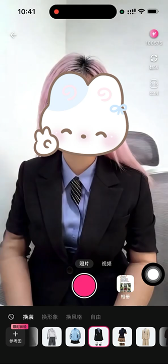

<p align="center">
  
</p>

<p align="center">
  <a href="https://developer.apple.com/macos/"></a>
  <a href="https://www.swift.org/"></a>
  <a href="https://platform.xmaxai.com/"></a>
  <a href="./LICENSE"></a>
</p>

We introduce XmaxSDK, a native macOS SDK designed for real-time interactive video generation via Xmax models. XmaxSDK implements an end-to-end pipeline covering media acquisition, video streaming, frame-by-frame generation, and on-device rendering, enabling developers to seamlessly integrate low-latency, high-fidelity video transformations into creative applications at a much lower cost than alternative solutions.

<br>

## What you can build with XmaxSDK

| Realtime Use Case | Description | Generation Conditions | Demo |
| --- | --- | --- | --- |
| **Character Swapping** | Replace a person in a live camera feed with a reference character. | Prompt: `视频中角色替换成参考图中角色`. Use a clear reference image of the desired character. | <a href="./Materials/videos/use-cases/character-swapping.mp4"><br>▶ Play demo</a> |
| **Virtual Try-On** | Apply a reference outfit to a person in a live feed. | Prompt: `视频中人物衣服替换成参考图中衣服`. Use an image of the target outfit; enable `faceRestoration` to preserve the original face. | <a href="./Materials/videos/use-cases/virtual-try-on.mp4"><br>▶ Play demo</a> |
| **Video Restyling** | Transform a live scene into a reference visual style. | Prompt: `视频风格变为参考图指定的风格`. Use an image showing the desired style. | <a href="./Materials/videos/use-cases/video-restyling.mp4"><br>▶ Play demo</a> |
| **Free Prompt** | Direct the transformation with your own prompt and optional reference image. | Pass a `RealtimeContext` when starting generation or updating an active session. | — |

The current macOS SDK supports camera input and caller-owned external video input.
Static images and local video files are not exposed as built-in realtime inputs.
Reference images are generation conditions, separate from the input video stream.

<br>

## Why XmaxSDK?

| Realtime pipeline | Native integration | Flexible capture |
| --- | --- | --- |
| Capture, stream, generate, and display video; update generation conditions without creating a new session. | Use Swift concurrency, AppKit or SwiftUI views, and listeners for state, network quality, and performance. | Enumerate and switch cameras, or supply processed NV12 / BGRA frames from your own video source. |

<br>

## Prerequisites

- macOS 13.0 or later
- Xcode 26 or later with a Swift 6.2+ compiler, using Swift 6 language mode
- An Xmax API key for remote generation
- A camera for the built-in capture pipeline, or an external video source

The packaged dependencies include Apple silicon (`arm64`) and Intel (`x86_64`)
macOS binaries. Frame interpolation is optional, disabled by default, and requires
macOS 26 or later and supported hardware.

Provide your API key at runtime. Local camera preview does not require an API key.

<br>

## Installation

XmaxSDK supports [**Swift Package Manager**](#swift-package-manager) and
[**CocoaPods**](#cocoapods), using the same SDK sources.
Version `1.0.0` is currently under development. Until a version tag is published,
select the `feature/yueting-v1.0.0` branch or use a local checkout.

### Swift Package Manager

In Xcode, choose **File → Add Package Dependencies**, enter the repository URL,
select a branch or published version, and add the **XmaxSDK** product to your
application target:

```text
https://github.com/XingMai/XmaxSDK-MacOS.git
```

For local development, choose **Add Local** and select the SDK checkout instead.
A Swift package can reference the local checkout:

```swift
.package(path: "/path/to/XmaxSDK")
```

SwiftPM resolves Agora RTC from its official package. COS is downloaded as macOS
dynamic XCFrameworks from the [COS dependency release](https://github.com/XingMai/XmaxSDK-MacOS/releases/tag/cos-6.5.7-spm.1),
with SHA-256 checksums pinned in `Package.swift`. Xcode handles linking, embedding,
and signing.
Consumers do not need CocoaPods or a separate COS build when using SwiftPM.

### CocoaPods

Add the following to your application's `Podfile`, pointing `:path` to your local
SDK checkout:

```ruby
source 'https://cdn.cocoapods.org/'

platform :osx, '13.0'

use_frameworks! :linkage => :static

target 'YourApp' do
  pod 'XmaxSDK', :path => '/path/to/XmaxSDK'
end

post_install do |installer|
  installer.pods_project.targets.each do |target|
    target.build_configurations.each do |configuration|
      configuration.build_settings['MACOSX_DEPLOYMENT_TARGET'] = '13.0'
    end
  end
end
```

Install the dependencies and open the generated `.xcworkspace`:

```bash
pod install --repo-update
```

CocoaPods obtains Agora and COS from their official Pods, using the dependencies'
own resource packaging. Add the SDK through one package manager per application
target to avoid duplicate dependencies.
See the [installation guide](./Materials/installation.md) for packaging and target
configuration details.

<br>

## Quick Start

### Configure permissions

Add a camera usage description to your application's `Info.plist`:

```xml
<key>NSCameraUsageDescription</key>
<string>This app uses the camera for real-time video input.</string>
```

If you enable microphone input, also add:

```xml
<key>NSMicrophoneUsageDescription</key>
<string>This app uses the microphone for real-time audio input.</string>
```

Customize these messages for your application. The SDK requests camera permission
when creating the camera stream. Microphone input is disabled by default; pass
`useMicrophone: true` to request it when creating the stream.

For sandboxed applications, enable **Camera** and **Outgoing Connections (Client)**
in the application target's App Sandbox capabilities, plus **Audio Input** if using
the microphone. Configure the corresponding resource permissions when using
Hardened Runtime. The [XLab entitlements](./Examples/XLab/XLab/XLab.entitlements)
provide an example; permissions belong to the host application.

<br>

### Create and display a camera stream

Run the following in a `@MainActor` async context. Retain the client, realtime
manager, streams, and video views for the lifetime of your screen.

```swift
import AppKit
import XmaxSDK

let client = XmaxClient(
    configuration: XmaxConfiguration(apiKey: "YOUR_XMAX_API_KEY")
)

let realtime = client.createRealtimeManager(
    options: RealtimeConfiguration(model: .x2_1_1_preview_cn)
)

await realtime.setStateListener { state in
    print("State: \(state.connectionState.rawValue)")
    if case .failure(let error) = state.reason {
        print("Error: \(error.code.rawValue) \(error.message)")
    }
}

let localStream = try await realtime.createLocalCameraStream()
let localView = XmaxVideoView(
    track: localStream.videoTrack,
    videoContentMode: .fit
)
let resultView = XmaxVideoView(videoContentMode: .fit)
```

Add `localView` and `resultView` to your window, with the local preview on the left
and generation results on the right. Camera input becomes `ready` after a valid
frame arrives **and the local preview view is bound in a window**. Observe this
through `setStateListener` before starting generation.

The default camera output is `1920 × 1024 @ 30 fps`. To select a device, call
`listCameraDevices()` and pass its identifier to `createLocalCameraStream(deviceID:)`.
Omitting the identifier selects the system default camera.

<br>

### Start and update generation

After the camera has entered `ready`, start generation using the local stream and
bind the returned remote track to your result view. Launch this from your screen's
state handling or a user action after readiness; creating the stream alone does
not complete preview binding.

```swift
let remoteStream = try await realtime.startGeneration(
    localStream: localStream,
    context: RealtimeContext(
        prompt: "视频中角色替换成参考图中角色",
        referencePath: "https://platform.xmaxai.com/images/source/charx/chatx_image1.jpg"
    )
)

resultView.track = remoteStream.videoTrack
```

Update conditions during an active session without recreating the camera stream:

```swift
try await realtime.startGeneration(
    context: RealtimeContext(prompt: "让画面呈现电影质感")
)
```

For your own reference images, create a storage manager with
`try client.createStorageManager()`, upload the image, and use the returned URL's
`absoluteString` as `RealtimeContext.referencePath`.
Handle errors thrown by async operations with `do/catch`.

<br>

### Using SwiftUI

Store local and remote tracks in observable state and bind them to separate
`XmaxVideo` views for a side-by-side layout:

```swift
import SwiftUI
import XmaxSDK

struct GenerationVideoView: View {
    let localTrack: RealtimeVideoTrack?
    let remoteTrack: RealtimeVideoTrack?

    var body: some View {
        HStack(spacing: 12) {
            XmaxVideo(track: localTrack, videoContentMode: .fit)
            XmaxVideo(track: remoteTrack, videoContentMode: .fit)
        }
    }
}
```

For a single video surface that transitions from local preview to generated
output after the first remote frame arrives, use `XmaxRealtimeVideo` in SwiftUI
or `XmaxRealtimeVideoView` in AppKit.
See [XLab](#example-project) for a complete SwiftUI implementation of the
side-by-side camera and result layout.

<br>

### Listen for events

Register listeners before creating the input stream or starting generation.

| Listener | Purpose |
| --- | --- |
| `setStateListener` | Observe connection and generation state, readiness, and termination reasons. |
| `setLaunchTimingListener` | Receive session creation, RTC join, local publication, first remote frame, and total startup durations. |
| `setRemoteVideoFrameListener` | Receive generated frames for custom processing. |
| `setUplinkVideoStatisticsListener` | Observe local publication resolution, frame rate, and bitrate. |
| `setDownlinkVideoStatisticsListener` | Observe received video statistics. |
| `setNetworkQualityListener` | Monitor uplink and downlink network quality. |
| `setPerformanceAlarmListener` | Observe device performance limitations and recovery. |

Workflow-ending failures are also available through `state.reason` after cleanup.
Keep remote frame callbacks lightweight and move expensive work to your own queue.

<br>

### External video input

If your application owns camera capture, decoding, or preprocessing, implement
`RealtimeExternalVideoSource` and bind it instead of creating an SDK camera stream:

```swift
let localStream = try await realtime.createExternalVideoStream(
    source: source,
    videoFormat: RealtimeVideoFormat(width: 1920, height: 1024, fps: 30)
)
```

The source receives a `RealtimeExternalFrameSink` in `start(sink:)`. When
`sink.isRequestingFrames` is `true`, continuously supply video-range NV12 (`420v`)
or BGRA (`32BGRA`) pixel buffers matching `sink.videoFormat`, with strictly
increasing, nonnegative monotonic timestamps in microseconds. The SDK copies
pixels synchronously; buffers may be reused after `pushVideo` returns.

External input becomes `ready` when binding succeeds, without waiting for preview
attachment or an input frame. Supply frames as soon as requested, including while
`startGeneration` is still awaiting startup. Your source owns permissions, frame
pacing, rotation, mirroring, resizing, and capture cleanup. External audio is not
supported in this version.

See the [external video integration guide](./Examples/ExternalVideo/README.md)
for a complete source adapter, optional preview hosting, and threading contracts.

<br>

### Resource Cleanup

- **`disconnect()` — Stop Remote Generation**

  Ends the remote session while retaining the local camera preview or external
  source binding. Start another session using the same local stream when needed:

  ```swift
  await realtime.disconnect()
  ```

- **`close()` — Full Teardown & Release**

  Ends generation, stops SDK-owned camera capture, unbinds any external source,
  and releases session and RTC resources. Call this when leaving the screen:

  ```swift
  await realtime.close()
  ```

Call `close()` directly when ending the workflow; there is no need to call
`disconnect()` first. Removing a video view only detaches rendering. Caller-owned
capture resources remain the application's responsibility.

<br>

For more examples, see the [usage guide](./Materials/usage.md).

<br>

## Example Project

Open [`Examples/XLab/XLab.xcodeproj`](./Examples/XLab/XLab.xcodeproj) in Xcode,
select the **XLab** scheme, and run it on your Mac. The example uses the SDK through
a local Swift package reference.

XLab follows the Web X-Lab interaction and visual style, with a local camera view
on the left and generated results on the right. It demonstrates:

- Camera startup with optional microphone input
- Character Swapping, Virtual Try-On, Video Restyling, and Free Prompt
- Reference image presets, local uploads, upload progress, and retry
- Model selection and a locally persisted API key using `UserDefaults`
- Live stream statistics and the five startup timing metrics
- Remote audio volume and optional frame interpolation

Kingfisher is an **example-only dependency** for reference image loading and
caching. Preset thumbnails request 160 px WebP images through COS image processing;
generation continues to use the original reference image URLs.

<br>

Shared branding and demonstration media are in [Materials](./Materials/README.md).
The copied iOS XLab screenshots are design references; the native macOS example
uses the side-by-side layout described above.

<br>

## Dependencies

| Dependency | Version | Purpose |
| --- | --- | --- |
| **Agora RTC SDK for macOS** | `4.6.2` (`RtcBasic`) | Realtime video transport and optional microphone audio. |
| **Tencent Cloud COS SDK** | `6.5.7` | Object storage uploads and downloads. |

SwiftPM downloads Xmax-built dynamic COS frameworks; CocoaPods uses official source
dependencies. The COS build origin and distribution are documented in the
[installation guide](./Materials/installation.md#swift-package-manager).
[Redistribution notices](https://github.com/XingMai/XmaxSDK-MacOS/releases/download/cos-6.5.7-spm.1/COS-6.5.7-NOTICES.txt)
are included in the framework resources and the COS dependency release.
Retain the third-party licenses and privacy manifests when redistributing dependencies.

<br>

## Contact us

For bug reports and feature requests, open a
[GitHub Issue](https://github.com/XingMai/XmaxSDK-MacOS/issues).
For integration assistance, contact [sdk@xmax.ai](mailto:sdk@xmax.ai).

<br>

## License

XmaxSDK is available under the terms of the [MIT License](./LICENSE).

Copyright (c) 2026 XMAX.AI PTE. LTD.
